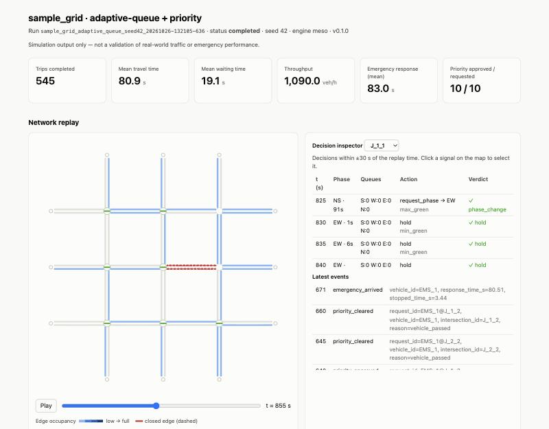
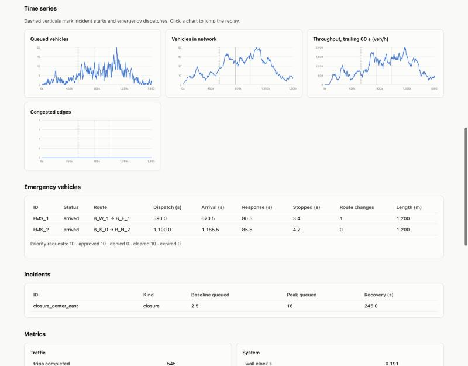
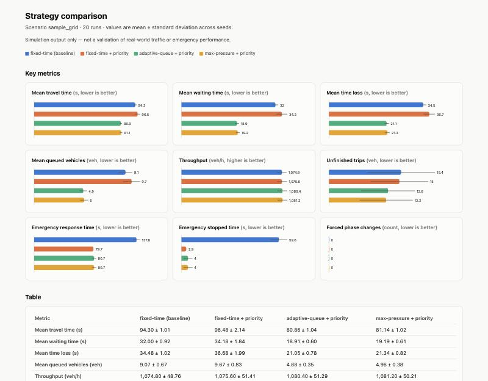

# Multi-Agent Traffic Management and Emergency Routing Simulator

A Python simulator for experimenting with cooperating software agents that run traffic signals and route emergency vehicles through a simulated city. Each signalized intersection has its own agent. A dispatcher plans and re-plans emergency routes. A priority coordinator asks intersections along the route for time-limited green phases. Every signal command goes through a safety-validation layer before it reaches the traffic engine.

The project is for **students, researchers, and developers** studying intelligent transportation systems and multi-agent coordination. It lets you compare control strategies against a fixed-time baseline using repeatable scenarios and random seeds. Each run produces metrics, structured logs, and an interactive HTML report.

> **Simulation only.** This tool is not connected to, and must not be used to control, real traffic infrastructure or emergency fleets. Results do not show real-world safety, legal compliance, or guaranteed response-time improvements.

**Status:** working prototype (v0.1.0). It covers the design's first milestone end to end: a sample network, a fixed-time baseline, adaptive intersection agents, emergency dispatch and rerouting, a road closure, bounded signal priority, metrics, and reports. The full design is in [docs/design-spec.md](docs/design-spec.md).

## Contents

- [Screenshots](#screenshots)
- [Features](#features)
- [How it works](#how-it-works)
- [Tech stack](#tech-stack)
- [Getting started](#getting-started)
- [Usage](#usage)
- [Configuration](#configuration)
- [Writing scenarios](#writing-scenarios)
- [Project structure](#project-structure)
- [Tests](#tests)
- [Results](#results)
- [Limitations](#limitations)
- [Roadmap](#roadmap)
- [Support](#support)
- [Author](#author)
- [License](#license)

## Screenshots

The run report replays the whole simulation. Edges are colored by occupancy. The closed road segment is dashed red, and the green bar at each signal shows which axis currently has green. The decision inspector lists each intersection agent's observations, actions, and validator verdicts near the current replay time.



The same report also shows time series, emergency-vehicle outcomes, and incident recovery:



`trafficsim compare` runs several strategies over matched seeds and charts the mean and standard deviation of each metric:



## Features

**Simulation**
- Built-in mesoscopic, queue-based traffic engine. Vehicles travel along edges with density-dependent speeds and queue at stop lines, and queues discharge at a saturation flow rate. Full downstream edges cause spillback.
- Signals always go green → yellow → all-red → green. Nothing discharges during yellow or all-red, and the engine refuses commands while a transition is in progress.
- Road networks are either generated grids or custom node/edge lists. Each signalized junction gets a two-phase (NS / EW) plan derived from its geometry.
- Time-varying Poisson demand between any nodes, with per-vehicle route randomization for realistic route diversity.
- Incidents: full road closures (vehicles reroute around them) and slowdowns (speed reduction), each with start and end times.

**Agents**
- **Intersection signal agents.** There is one agent per intersection, and three policies are available:
  - `fixed_time`: fixed green per phase. This is the baseline.
  - `adaptive_queue`: queue- and wait-weighted phase selection with hysteresis.
  - `max_pressure`: upstream queue minus downstream queue.
- **Emergency dispatch and routing agent.** Plans routes with Dijkstra's algorithm over live edge-cost estimates (travel time plus queue discharge delay). It reroutes when a closure blocks the route, or when a periodic check finds a route that is cheaper by more than a configurable threshold.
- **Priority coordinator.** Sends time-limited priority requests to intersections on the emergency route within an ETA horizon. Requests are cleared when the vehicle passes, reroutes, or arrives, and expire after a hard time limit.
- **Traffic monitor.** Detects congestion per edge using thresholds with hysteresis and publishes events on an in-process message bus.
- **Incident manager.** Applies and resolves scheduled incidents and notifies subscribers.

**Safety and reliability**
- An action validator checks every command for:
  - valid schema and phase
  - minimum green
  - maximum green (applied when conflicting traffic is waiting)
  - that a priority request is eligible and matches the requested phase
  - a cap on how long priority can extend a phase
  - a per-intersection fairness budget, so priority cannot starve cross traffic
- The orchestrator forces a phase change if a phase passes maximum green while conflicting traffic is waiting and no approved priority applies.
- A crashing or malformed agent does not stop the run. That decision falls back to a fixed-time controller. After three consecutive faults, the fallback replaces the agent permanently, and the replacement is logged.
- Configuration is validated before a run starts. Unknown keys, unknown strategies, missing files, unsafe timing (yellow < 3 s, all-red < 1 s, min green < 5 s), and impossible routes are all rejected.

**Experiments and outputs**
- Runs are reproducible. A fixed seed gives identical results, and each run's manifest records the config, scenario SHA-256, software and policy versions, and the seed.
- Each run writes `manifest.json`, `summary.json`, `events.jsonl`, `decisions.jsonl`, `timeseries.csv`, `trips.csv`, and a self-contained `report.html`. The report includes a map replay, decision inspector, time series, event timeline, and light/dark themes.
- `compare` runs several configs over several seeds and writes CSV/JSON aggregates and an HTML comparison page. It warns if the configs use different scenario files.

## How it works

```text
             trafficsim CLI (run | compare | validate)
                              │
                 ┌────────────▼─────────────┐
                 │   Simulation orchestrator │  clock, seed, run lifecycle,
                 │                           │  decision scheduling, outputs
                 └──┬───────────────────┬────┘
                    │                   │
   ┌────────────────▼──────┐   ┌────────▼───────────────────────────────┐
   │ Traffic engine adapter │   │ Agents                                 │
   │ (TrafficEngine ABC)    │◄──┤  signal agents (one per intersection)  │
   │  └ MesoEngine          │   │  emergency dispatch / routing          │
   │    queues, signals,    │   │  priority coordinator                  │
   │    incidents, spillback│   │  traffic monitor, incident manager     │
   └────────────────┬──────┘   └────────┬───────────────────────────────┘
                    │      ┌────────────▼────────────┐
                    └─────►│ Action validator        │ min/max green, priority
                           │                         │ eligibility, fairness budget
                           └────────────┬────────────┘
                           ┌────────────▼────────────┐
                           │ Metrics, event log,     │──► JSON / CSV / HTML report
                           │ decision log            │
                           └─────────────────────────┘
```

Every simulation step (1 s by default) goes through this loop:

1. Scheduled incidents start or end, and the dispatcher releases or reroutes emergency vehicles.
2. Due passenger vehicles are routed and handed to the engine.
3. The engine advances: signal timers, stop-line arrivals, queue discharge, and insertions.
4. Completed trips are recorded, and the monitor updates congestion state.
5. At each decision interval (5 s by default), the coordinator refreshes priority requests. Then, for each intersection on green:
   1. The validator screens the requests for fairness and hold limits.
   2. The agent decides on an action.
   3. The validator checks the action.
   4. Accepted actions go to the engine.
   5. Everything is written to the decision log.
6. At each sample interval, metrics and a replay frame are recorded.

Agents work through the abstract `TrafficEngine` interface in [src/trafficsim/engine/base.py](src/trafficsim/engine/base.py), so policy code doesn't depend on a particular simulator.

## Tech stack

| Component | Used for |
|---|---|
| Python 3.10+ (developed and tested on 3.12) | Engine, agents, orchestration, CLI |
| [PyYAML](https://pyyaml.org/) | Run configs and scenario files |
| [pytest](https://pytest.org/) (dev only) | Unit, integration, and scenario tests |
| Plain HTML/SVG/JavaScript, generated by Python | Self-contained reports (no external scripts or build step) |

PyYAML is the only runtime dependency. The traffic engine is written in pure Python and needs no external simulator.

## Getting started

### Prerequisites

- Python 3.10 or newer (tested with 3.12 on macOS)
- `git`

### Install

```bash
git clone https://github.com/saksham23csu274/multi-agent-traffic-simulator.git
```

```bash
cd multi-agent-traffic-simulator
```

```bash
python3 -m venv .venv
```

```bash
source .venv/bin/activate
```

```bash
pip install -e ".[dev]"
```

This installs the `trafficsim` package and its command-line entry point in editable mode, along with pytest.

### Check the installation

```bash
trafficsim validate --config configs/adaptive_queue.yaml
```

Expected output:

```text
config OK: configs/adaptive_queue.yaml
scenario 'sample_grid': 21 nodes, 48 edges, 9 signalized, 396 demand flows, 1 incidents, 2 emergency requests
```

## Usage

### Run one simulation

```bash
trafficsim run --config configs/adaptive_queue.yaml
```

This runs the 30-minute sample scenario and prints a summary. The output below was captured from a real run; wall-clock time depends on your machine.

```text
status:               completed
trips completed:      545  (unfinished: 10)
mean travel time:     80.914 s
mean waiting time:    19.094 s
throughput:           1090.0 veh/h
emergency arrived:    2/2  mean response 83.01 s
priority requests:    10 (approved 10, denied 0, expired 0)
rejected actions:     4  forced phase changes: 0  agent faults: 0
wall clock:           0.191 s (9436.4 steps/s)
outputs:              runs/sample_grid_adaptive_queue_seed42_<timestamp>
```

You can override common settings without editing the config:

```bash
trafficsim run --config configs/adaptive_queue.yaml --strategy max_pressure --seed 7 --no-priority --duration 900 --output runs/experiments
```

You can also run it as a module with `python -m trafficsim ...`.

### Compare strategies over matched seeds

```bash
trafficsim compare --configs configs/baseline_fixed_time.yaml configs/fixed_time_priority.yaml configs/adaptive_queue.yaml configs/max_pressure.yaml --seeds 1 2 3 4 5 --output runs/compare_sample_grid
```

This writes `comparison.csv`, `comparison.json`, and `comparison.html` to the output folder, plus one subfolder per run. Each config needs a distinct `label`.

### View reports

Reports are standalone HTML files, so you can open `runs/<run_id>/report.html` directly in a browser. The comparison page links to each run's report by relative path. To browse a whole output folder, serve it locally:

```bash
python3 -m http.server 8765 --directory runs
```

Then open `http://localhost:8765/`.

### Run outputs

Each run writes the following files to `runs/<run_id>/`. You can turn individual outputs off under `outputs:` in the config.

| File | Contents |
|---|---|
| `manifest.json` | Run ID, timestamps, software/Python version, resolved config, scenario path and SHA-256, policy names and versions, seed, final status |
| `summary.json` | Traffic, emergency, incident, and system metrics (see [Results](#results)) |
| `events.jsonl` | Time-stamped events, such as incidents, dispatches, reroutes, priority requests/approvals/denials/clears/expiries, agent faults, forced phase changes, and congestion |
| `decisions.jsonl` | One record per agent decision: observation summary, action, validator verdict, engine result, latency |
| `timeseries.csv` | Sampled vehicles in network, queued vehicles, insert backlog, throughput (trailing 60 s), congestion, active emergencies |
| `trips.csv` | One row per completed trip: travel time, waiting time, depart delay, stops, route length, free-flow time, time loss, route changes |
| `report.html` | Interactive report with map replay, decision inspector, charts, and tables |
| `error.txt` | Traceback, written only if the run failed (partial outputs are still saved) |

### Use it as a library

```python
from trafficsim.config import load_run_config
from trafficsim.orchestrator import run_simulation

config = load_run_config("configs/adaptive_queue.yaml", {"random_seed": 3})
result = run_simulation(config, "runs", write_outputs=False)
print(result.summary["traffic"]["mean_waiting_time_s"])
```

To plug in your own signal policy, subclass `SignalAgent` in [src/trafficsim/agents/signal.py](src/trafficsim/agents/signal.py) and pass `agent_factory=` to `run_simulation`. The integration tests in [tests/test_integration.py](tests/test_integration.py) show how.

## Configuration

A run config is a YAML file. A relative `scenario` path is resolved from the config file's folder. Unknown keys are rejected. Every key is optional except `scenario`. The defaults below come from [src/trafficsim/config.py](src/trafficsim/config.py).

| Key | Purpose | Default |
|---|---|---|
| `scenario` | Path to the scenario YAML file (**required**) | — |
| `label` | Name shown in reports and comparisons | `<strategy>/<priority or no-priority>` |
| `random_seed` | Seed for demand generation and route randomization | `42` |
| `simulation.engine` | Traffic engine (only `meso` is implemented) | `meso` |
| `simulation.step_length_s` | Simulation step | `1.0` |
| `simulation.duration_s` | Simulated duration | `1800` |
| `simulation.decision_interval_s` | How often signal agents decide | `5` |
| `simulation.saturation_flow_vps_per_lane` | Queue discharge rate on green | `0.5` |
| `simulation.jam_spacing_m` | Space per stored vehicle (sets edge capacity) | `7.5` |
| `simulation.timeout_s` | Optional wall-clock limit (run ends with status `timeout`) | none |
| `traffic_control.strategy` | `fixed_time`, `adaptive_queue`, or `max_pressure` | `adaptive_queue` |
| `traffic_control.min_green_s` / `max_green_s` | Green bounds (min ≥ 5, max > min) | `8` / `45` |
| `traffic_control.yellow_s` / `all_red_s` | Clearance intervals (≥ 3 and ≥ 1) | `3` / `1` |
| `traffic_control.fixed_green_s` | Green per phase for `fixed_time` and the fallback controller | `25` |
| `traffic_control.hysteresis` | How much higher competing demand must be before an adaptive switch | `0.2` |
| `traffic_control.wait_weight` | Weight of mean wait in `adaptive_queue` demand | `0.1` |
| `emergency.enabled` | Dispatch emergency requests from the scenario | `true` |
| `emergency.routing_strategy` | `dynamic_shortest_path` (rerouting) or `static_shortest_path` | `dynamic_shortest_path` |
| `emergency.priority_enabled` | Allow signal priority for emergency vehicles | `true` |
| `emergency.reroute_threshold_percent` | Minimum cost improvement before switching routes | `15` |
| `emergency.reroute_interval_s` | Periodic reroute check interval | `10` |
| `emergency.priority_horizon_s` | Request priority from intersections within this ETA | `30` |
| `emergency.max_priority_hold_s` | How far priority may extend a phase beyond max green | `30` |
| `emergency.fairness_window_s` / `max_priority_share` | Per-intersection priority budget (share of the window) | `300` / `0.5` |
| `emergency.queue_jump` | Ordinary vehicles yield, so emergency vehicles move to the front of a queue | `true` |
| `monitoring.congestion_threshold` / `clear_threshold` | Occupancy ratios at which an edge becomes, or stops being, congested | `0.8` / `0.6` |
| `metrics.sample_interval_s` | Time-series and replay sampling interval | `5` |
| `outputs.directory` | Default output root | `runs` |
| `outputs.save_events` / `save_decisions` / `export_csv` / `html_report` | Toggle individual outputs | `true` |

The four shipped configs in [configs/](configs/) all use [scenarios/sample_grid.yaml](scenarios/sample_grid.yaml). They differ only in strategy and priority:

| Config | Strategy | Priority |
|---|---|---|
| `baseline_fixed_time.yaml` | `fixed_time` | off |
| `fixed_time_priority.yaml` | `fixed_time` | on |
| `adaptive_queue.yaml` | `adaptive_queue` | on |
| `max_pressure.yaml` | `max_pressure` | on |

## Writing scenarios

A scenario defines the network, demand, incidents, and emergency requests. Four are included:

| Scenario | What it exercises |
|---|---|
| [`sample_grid.yaml`](scenarios/sample_grid.yaml) | 3×3 grid, demand peak from 600–1500 s, a two-way closure from 600–1200 s that blocks the first emergency vehicle's route, and two emergency requests |
| [`grid_low_demand.yaml`](scenarios/grid_low_demand.yaml) | Light demand, no incidents, one emergency request on an uncongested route |
| [`grid_multi_emergency.yaml`](scenarios/grid_multi_emergency.yaml) | 4×4 grid, five emergency requests released close together (priority fairness), and a slowdown incident |
| [`corridor.yaml`](scenarios/corridor.yaml) | Custom-network example: a two-lane arterial with four signalized side streets |

The format:

```yaml
id: my_scenario
description: Free text shown in reports.
network:
  type: grid            # or "custom" with nodes/edges lists (see scenarios/corridor.yaml)
  rows: 3
  cols: 3
  block_length_m: 200
  speed_limit_mps: 13.9
  lanes: 1
route_noise: 0.2        # per-vehicle random edge-cost perturbation (0 = everyone takes the same shortest path)
demand:
  - origins: boundary   # a node id, a list of ids, or "boundary" for all unsignalized nodes
    destinations: boundary
    vehicles_per_hour: 6   # per origin-destination pair
    start_s: 0
    end_s: 900             # optional
incidents:
  - id: closure_1
    kind: closure          # or "slowdown" with speed_factor in (0, 1]
    edges: ["J_1_1->J_1_2"]
    start_s: 600
    end_s: 1200            # optional
emergencies:
  - id: EMS_1
    origin: B_W_1
    destination: B_E_1
    release_s: 590
    vehicle_class: ambulance
```

Grid node IDs are as follows:
- Junctions are `J_<row>_<col>`, with row 0 at the south.
- Boundary nodes are `B_N_<col>`, `B_S_<col>`, `B_W_<row>`, and `B_E_<row>`.
- Edge IDs are `<from>-><to>`.

## Project structure

```text
multi-agent-traffic-simulator/
├── configs/                  # run configurations (strategy, timing, priority, outputs)
├── scenarios/                # networks, demand, incidents, emergency requests
├── src/trafficsim/
│   ├── cli.py                # `trafficsim run | compare | validate`
│   ├── config.py             # config dataclasses, loading, safety validation
│   ├── scenario.py           # scenario loading/validation, Poisson demand generation
│   ├── network.py            # road graph, grid/custom builders, approaches, phases
│   ├── routing.py            # Dijkstra shortest path with blocked edges
│   ├── engine/
│   │   ├── base.py           # TrafficEngine adapter interface
│   │   └── meso.py           # built-in mesoscopic queue engine
│   ├── agents/
│   │   ├── signal.py         # fixed-time, adaptive-queue, max-pressure agents
│   │   ├── emergency.py      # dispatch/routing agent, priority coordinator
│   │   └── monitor.py        # traffic monitor, incident manager
│   ├── validation.py         # action validator, priority fairness budget
│   ├── orchestrator.py       # run loop, fault handling, manifest
│   ├── metrics.py            # metric collection and aggregation
│   ├── events.py             # event log, message bus
│   ├── models.py             # versioned observation/action/message schemas
│   ├── experiments.py        # multi-seed strategy comparison
│   ├── outputs.py            # JSON/JSONL/CSV writers
│   └── report.py             # HTML run and comparison reports
├── tests/                    # unit, integration, and scenario tests
└── docs/
    ├── design-spec.md        # full system design and phased plan
    ├── images/               # report screenshots used in this README
    └── results/              # comparison.csv / comparison.json from the run below
```

## Tests

```bash
pytest
```

The suite has 60 tests and runs in about 3 seconds. It covers:
- **Unit tests:** config and scenario validation, routing, signal transitions, saturation flow, spillback, closures, queue jumping, the validator's rules, and agent policies.
- **Scenario tests:** all four scenarios, seed reproducibility, emergency rerouting around a closure, priority vs. no priority, crashing and malformed agents falling back, output files, `compare`, and the CLI.

No linter or type checker is configured.

## Results

The table below shows observed results from one comparison run, made with this command:

```bash
trafficsim compare --configs configs/baseline_fixed_time.yaml configs/fixed_time_priority.yaml configs/adaptive_queue.yaml configs/max_pressure.yaml --seeds 1 2 3 4 5 --output runs/compare_sample_grid
```

**Conditions:**
- **Scenario:** `sample_grid`, 1800 s simulated, 1 s steps, decisions every 5 s.
- **Seeds:** 1–5, with the same seeds used for every strategy.
- **Timing:** min/max green 8/45 s, yellow 3 s, all-red 1 s.
- **Statistics:** values are the mean ± standard deviation across the 5 seeds.

Raw data is in [docs/results/comparison.csv](docs/results/comparison.csv) and [docs/results/comparison.json](docs/results/comparison.json).

| Metric | Fixed-time (baseline) | Fixed-time + priority | Adaptive-queue + priority | Max-pressure + priority |
|---|---|---|---|---|
| Mean travel time (s) | 94.3 ± 1.0 | 96.5 ± 2.1 | 80.9 ± 1.0 | 81.1 ± 1.0 |
| Mean waiting time (s) | 32.0 ± 0.9 | 34.2 ± 1.8 | 18.9 ± 0.6 | 19.2 ± 0.6 |
| Mean time loss (s) | 34.5 ± 1.0 | 36.7 ± 2.0 | 21.1 ± 0.8 | 21.3 ± 0.8 |
| Mean queued vehicles | 9.1 ± 0.7 | 9.7 ± 0.8 | 4.9 ± 0.3 | 5.0 ± 0.4 |
| Throughput (veh/h) | 1074.8 ± 48.8 | 1075.6 ± 51.4 | 1080.4 ± 51.3 | 1081.2 ± 50.2 |
| Unfinished trips at end | 15.4 ± 7.2 | 15.0 ± 6.1 | 12.6 ± 5.7 | 12.2 ± 5.6 |
| Emergency response time (s) | 137.8 ± 4.6 | 79.7 ± 0.6 | 80.7 ± 2.7 | 80.7 ± 2.7 |
| Emergency stopped time (s) | 59.6 ± 5.1 | 2.9 ± 0.3 | 4.0 ± 2.6 | 4.0 ± 2.6 |

**What this run shows** (for this scenario and model only):
- Signal priority cut emergency response time by about 42% and stopped time from about 60 s to 3–4 s.
- With fixed-time control, priority cost ordinary traffic about 2 s of extra mean waiting time. The report shows this trade-off directly instead of hiding it.
- The adaptive agents cut mean waiting time by about 41% compared with the fixed-time baseline.
- Throughput is nearly the same for all four strategies, because demand stays below network capacity.

These numbers come from a simplified, uncalibrated model. They show what the framework can measure; they do not predict real-world performance.

**Metric definitions:**
- Units are seconds, metres, vehicles, and vehicles per hour.
- Trip metrics include completed passenger trips only. Vehicles still in the network or waiting to enter at the end of a run are counted as unfinished.
- Response time runs from an emergency request's release to the vehicle's arrival.
- Time loss is travel time minus free-flow time.

## Limitations

- **Simplified traffic model.** The engine is mesoscopic. Turning movements are not modeled separately: each approach discharges as one FIFO queue, so a blocked turn holds up the vehicles behind it. Lane changing, gap acceptance, and pedestrians are not modeled. The engine has not been calibrated against real traffic data.
- **Two-phase signals only.** Phases are derived from geometry (NS vs. EW). There are no protected turn phases and no custom signal programs.
- **Emergency priority is a policy abstraction.** Emergency vehicles still wait for green. `queue_jump` approximates other vehicles yielding. Nothing here implies that emergency vehicles may ignore traffic laws or operational procedures.
- **Passenger rerouting is limited.** Ordinary vehicles reroute only when the next edge on their route is closed. They don't react to congestion.
- **Single engine.** Only the built-in `meso` engine is implemented. The `TrafficEngine` interface exists so others (for example SUMO via TraCI) can be added, but no such adapter ships yet.
- **Offline reports.** There is no live dashboard. Reports are generated after each run.
- **Limited testing.** Tested on Python 3.12 on macOS only. Large networks have not been benchmarked: the sample 3×3 grid runs at roughly 9,000 steps/s on an Apple M4, and performance on larger networks has not been measured.

## Roadmap

- [ ] SUMO/TraCI engine adapter behind the existing `TrafficEngine` interface
- [ ] Live web dashboard (run controls, streaming map, live metrics)
- [ ] Turn-specific movements and protected-turn phase plans
- [ ] Optional network-level coordinator (corridor priorities, congestion costs) with ablation experiments
- [ ] Congestion-aware rerouting for ordinary vehicles
- [ ] Actuated-control baseline and sensitivity analysis across demand levels
- [ ] Learning-based signal policies, once the benchmark and safety layer are stable

## Support

For questions or bug reports, open an issue in this repository. Include the run's `manifest.json`, the command you used, and `error.txt` if the run failed.

## Author

Saksham Mathur

## License

Released under the [MIT License](LICENSE).
